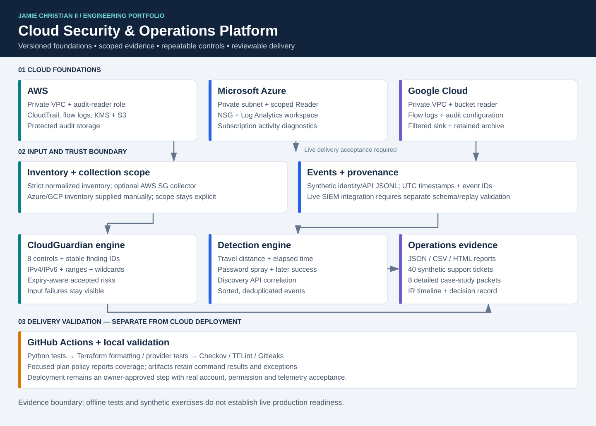

# ☁️🛡️ Cloud Security & Operations Platform

### Multi-Cloud Engineering • Security Operations • IAM • Python Automation • DevSecOps


**An integrated, production-inspired cloud security and operations portfolio demonstrating how to design secure infrastructure, manage identity, troubleshoot incidents, investigate threats, automate security assessments, validate infrastructure changes, and continuously improve cloud operations.**

**Repository:** [cloud-security-operations-platform](https://github.com/JamieChristian22/cloud-security-operations-platform)

[🚀 Quick Start](#-quick-start) | [🏗️ Architecture](#-platform-architecture) | [🧩 Projects](#-five-integrated-projects) | [🧪 Validation](#-testing--validation) | [🔍 Technical Walkthrough](#-end-to-end-technical-walkthrough) | [📚 Documentation](#-documentation-index)

---

## 🎯 Executive Overview

The **Cloud Security & Operations Platform (CSOP)** is a multi-cloud engineering and cybersecurity portfolio centered on **Northstar Digital Services**, a fictional, remote-first SaaS organization with approximately 750 users.

The portfolio models how cloud engineering, infrastructure operations, security teams, and governance functions work together to protect technology services.

Rather than treating cloud infrastructure, support, cybersecurity, and automation as separate disciplines, CSOP demonstrates an integrated engineering lifecycle.

**Design → Secure → Operate → Monitor → Detect → Investigate → Respond → Automate → Validate → Improve**

### Business Problem

A growing technology organization operating across multiple cloud platforms faces several challenges:

- Inconsistent cloud security configurations
- Excessive or outdated identity permissions
- Unnecessary internet-facing infrastructure
- Repeated technical support incidents
- Limited security event visibility
- Manual configuration auditing
- Inconsistent change validation
- Recovery-readiness uncertainty
- Incomplete technical documentation
- Difficulty identifying ownership and operational risk

### Engineering Approach

CSOP addresses these challenges through five interconnected engineering projects.

| Project | Engineering Focus | Operational Value |
|---|---|---|
| 01 — Multi-Cloud Foundation & IAM | Infrastructure and identity security | Consistent cloud security foundations |
| 02 — Cloud Support & Reliability | Troubleshooting and operations | Repeatable restoration procedures |
| 03 — Security Operations & Incident Response | Threat detection and investigation | Structured incident handling |
| 04 — CloudGuardian Security Auditor | Python security automation | Repeatable configuration assessments |
| 05 — DevSecOps Infrastructure Delivery | Infrastructure security validation | Identify unsafe changes before delivery |

### Portfolio Scope

**Northstar Digital Services is fictional.** The environment uses simulated infrastructure scenarios, synthetic incident records, sample inventories, and local validation exercises.

The repository demonstrates implementation, analytical reasoning, operational procedures, and engineering methodology. It does not imply that these activities occurred within an employer's live production environment.

---

## 🏗️ Platform Architecture



### Architecture Layers

| Layer | Technical Components | Security and Operational Purpose |
|---|---|---|
| Identity | IAM, RBAC, MFA policy expectations, access reviews | Control who can access resources |
| Infrastructure | Terraform, AWS, Azure, GCP | Define repeatable cloud foundations |
| Networking | Security groups, private networking, access restrictions | Reduce unnecessary connectivity |
| Operations | Support tickets, runbooks, monitoring exercises | Maintain service reliability |
| Detection | Python-based detection logic, synthetic telemetry | Identify suspicious activities |
| Incident Response | Investigation timelines, evidence, containment | Respond consistently to threats |
| Security Automation | CloudGuardian auditing engine | Identify and prioritize configuration weaknesses |
| Delivery Security | Terraform tests, policy-as-code | Evaluate proposed infrastructure changes |
| Governance | Threat modeling, cost controls, DR planning | Support operational accountability |
| Validation | pytest, control scripts, generated reports | Produce reproducible local evidence |

### Data and Control Flow

```text
                 USERS / ENGINEERS
                        |
                        v
               IDENTITY & ACCESS
               IAM / RBAC / MFA
                        |
          +-------------+-------------+
          |             |             |
          v             v             v
         AWS          AZURE          GCP
          |             |             |
          +-------------+-------------+
                        |
                        v
            TERRAFORM INFRASTRUCTURE
                        |
                        v
               CLOUD OPERATIONS
           Support / Monitoring / RCA
                        |
             +----------+----------+
             |                     |
             v                     v
       SECURITY DETECTION     CLOUDGUARDIAN
       Events / IOCs / IR     Inventory Audits
             |                     |
             +----------+----------+
                        |
                        v
             FINDINGS & REMEDIATION
                        |
                        v
               DEVSECOPS CONTROLS
             Tests / Policy Checks
                        |
                        v
                 HUMAN REVIEW
                        |
                        v
              CONTROLLED CHANGES
                        |
                        v
              CONTINUOUS IMPROVEMENT
```

**Architecture interpretation:** The diagram represents an engineering reference model and logical interactions. It is not a claim that all components are deployed as live, interconnected production services.

### Security Design Decisions

**Identity-first architecture:** Permissions and trust relationships are treated as critical security boundaries. Human access, workload access, and privileged actions require different control considerations.

**Private-first networking:** Infrastructure designs favor restricted connectivity and explicit access requirements rather than unnecessary public exposure.

**Evidence-based operations:** Troubleshooting and investigation activities emphasize observable evidence before remediation.

**Automated guardrails:** Repeatable checks are used to evaluate policy requirements and identify configuration weaknesses.

**Human-controlled changes:** Automated tests support decision-making but do not replace approval and contextual risk review.

---

## 🧩 Five Integrated Projects

## ☁️ 01 — Multi-Cloud Foundation & IAM

**Secure infrastructure design and identity governance across AWS, Microsoft Azure, and Google Cloud.**

[📂 Explore Project 01](01-multi-cloud-foundation-iam/)

### Technical Scope

- Multi-cloud Terraform architecture
- Provider-specific infrastructure modules
- IAM roles and scoped permissions
- RBAC and least-privilege design
- MFA expectations
- Privileged-access considerations
- Joiner-Mover-Leaver lifecycle
- Periodic access reviews
- Security logging
- Network segmentation
- Private-first access design
- Terraform security test definitions

### Engineering Considerations

| Control Area | Risk | Engineering Approach |
|---|---|---|
| Identity Permissions | Excessive resource privileges | Scoped role and permission design |
| Privileged Access | Unauthorized administrative actions | Restricted elevated-access patterns |
| Credential Management | Unauthorized credential use | Review and lifecycle controls |
| Networking | Publicly exposed management services | Restricted ingress and segmentation |
| Resource Governance | Unowned cloud resources | Ownership and environment metadata |
| Infrastructure Changes | Configuration inconsistency | Terraform definitions and validation |

### Technical Evidence

- [Terraform Infrastructure](01-multi-cloud-foundation-iam/terraform/)
- [Cloud Modules](01-multi-cloud-foundation-iam/terraform/modules/)
- [Terraform Tests](01-multi-cloud-foundation-iam/terraform/tests/)
- [IAM Governance](01-multi-cloud-foundation-iam/governance/)
- [Security Checklist](01-multi-cloud-foundation-iam/validation/security-checklist.md)

### Interview Discussion

This project provides evidence for discussing:

- Identity trust versus permissions
- Human identities versus workload identities
- The principle of least privilege
- Terraform module reuse
- Network security boundaries
- Access governance and auditability
- Infrastructure configuration testing

---

## 🛠️ 02 — Cloud Support & Reliability Center

**Technical troubleshooting, incident management, service restoration, and operational analytics.**

[📂 Explore Project 02](02-cloud-support-reliability-center/)

### Project Evidence

- **40 synthetic incident tickets**
- **Eight operational troubleshooting runbooks**
- Technical case studies
- Root-cause analysis documentation
- Ticket metrics processing
- Operational improvement recommendations

### Incident Coverage

| Category | Example Investigation |
|---|---|
| IAM | Access denied due to incorrect permissions |
| Cloud Networking | Private service connectivity failure |
| Authentication | Microsoft 365 sign-in issue |
| Linux | Disk utilization and resource pressure |
| DNS | Private DNS resolution failure |
| Monitoring | Missing or ineffective operational alert |
| Backup | Restoration and validation scenario |
| DevSecOps | Infrastructure policy or pipeline failure |

### Standard Incident Lifecycle

```text
Incident Reported
       |
       v
Assess Priority & Impact
       |
       v
Collect Logs and Evidence
       |
       v
Develop Root-Cause Hypothesis
       |
       v
Perform Controlled Remediation
       |
       v
Verify Service Recovery
       |
       v
Document Resolution
       |
       v
Identify Preventive Improvement
```

### Example: IAM Access-Denied Investigation

**Scenario:** A cloud user reports being unable to access an authorized resource.

**Investigation approach:**

1. Confirm the affected identity and resource.
2. Verify the identity's assigned roles.
3. Examine permissions and relevant policy conditions.
4. Check applicable deny rules or permission boundaries.
5. Review available access-denied evidence.
6. Determine whether access is legitimately required.
7. Recommend the smallest authorized permission change.
8. Retest access and document the outcome.

The objective is to restore appropriate access without introducing unnecessary privileges.

### Operational Metrics

The portfolio includes ticket data and a Python analytics script.

Relevant KPIs include:

- Ticket volume
- Incident categories
- Incident severity
- Resolution duration
- SLA performance, where supported by source records
- Recurring-incident trends

Actual KPI values should be calculated from the included dataset rather than assumed.

### Technical Evidence

- [Incident Tickets](02-cloud-support-reliability-center/tickets/)
- [Operational Runbooks](02-cloud-support-reliability-center/runbooks/)
- [Technical Case Studies](02-cloud-support-reliability-center/case-studies/)
- [Ticket Dataset](02-cloud-support-reliability-center/data/tickets.csv)
- [Ticket Analytics Script](02-cloud-support-reliability-center/scripts/ticket_metrics.py)
- [RCA Trends](02-cloud-support-reliability-center/RCA-TRENDS.md)

---

## 🛡️ 03 — Security Operations & Incident Response

**Security event analysis, detection engineering, incident investigation, containment, and recovery.**

[📂 Explore Project 03](03-security-operations-incident-response/)

### Incident Scenario

The project models a simulated **SEV-2 cloud credential-compromise incident**.

The exercise examines how suspicious authentication activity can be investigated and escalated using structured evidence.

### Incident Response Lifecycle

| Phase | Engineering Activities |
|---|---|
| Preparation | Establish response procedures and investigation readiness |
| Identification | Review alerts and suspicious activity |
| Analysis | Evaluate indicators, timestamps, accounts and affected services |
| Containment | Determine appropriate access restrictions |
| Eradication | Address compromised credentials or unsafe configurations |
| Recovery | Restore authorized access and monitor for recurrence |
| Post-Incident Review | Document root causes, lessons and corrective controls |

### Detection Engineering

The portfolio includes three security-detection scenarios.

| Detection | Purpose | Key Considerations |
|---|---|---|
| Credential Compromise | Flag indicators of unauthorized credential use | Identity context, timing, suspicious behavior |
| Impossible Travel | Identify geographically inconsistent sign-ins | Event timing, location reliability, false positives |
| Password Spray | Identify authentication attempts across multiple accounts | Time windows, account counts and thresholds |

### Detection Quality

A useful security detection should document:

- Data source and required fields
- Detection logic
- Thresholds and time windows
- Expected behavior
- Known false-positive conditions
- Investigation steps
- Escalation requirements
- Testing evidence

A triggered alert is an investigation lead rather than automatic proof of compromise.

### Technical Evidence

- [Security Operations Project](03-security-operations-incident-response/)
- [Post-Incident Report](03-security-operations-incident-response/post-incident-report.md)
- [SIEM Documentation](03-security-operations-incident-response/siem/)
- [Detection Runner](scripts/security/run_detections.py)

---

## 🤖 04 — CloudGuardian Security Auditor

**Automated cloud-security configuration assessments using Python.**

[📂 Explore Project 04](04-cloudguardian-security-auditor/)

CloudGuardian is a Python security auditing application that analyzes normalized inventory fixtures against configurable security expectations.

It generates prioritized findings and provides evidence for remediation review.

### Security Checks

| Security Weakness | Risk Category | Suggested Remediation |
|---|---|---|
| Missing MFA | Identity security | Require MFA for applicable identities |
| Dormant enabled accounts | Account lifecycle | Review and disable unused access |
| Stale access keys | Credential security | Rotate or revoke unnecessary credentials |
| Wildcard permissions | Authorization | Replace broad permissions with scoped access |
| Public storage | Data exposure | Restrict public access where inappropriate |
| Open SSH/RDP | Network exposure | Restrict management access to approved sources |
| Missing ownership metadata | Governance | Assign accountable resource ownership |

### Security Assessment Process

```text
Normalized Inventory
        |
        v
Input Validation
        |
        v
Security Control Evaluation
        |
        v
Finding Classification
        |
        v
Risk Prioritization
        |
        v
JSON / CSV / HTML Reports
        |
        v
Remediation Review
        |
        v
Reassessment
```

### Example Security Finding

The following is an **illustrative finding format**, not a copied result from a live scan.

```json
{
  "finding_id": "EXAMPLE-001",
  "control": "MFA_REQUIRED",
  "resource_type": "identity",
  "resource_id": "demo-user-01",
  "severity": "HIGH",
  "status": "OPEN",
  "observation": "MFA is not enabled",
  "recommendation": "Enable MFA and verify enforcement"
}
```

This example demonstrates the type of information that makes findings actionable: affected resources, control identifiers, severity, observations, and recommended actions. The actual CloudGuardian output schema should be reviewed in the source code and generated reports.

### Remediation Verification

**Before:**

A sample inventory contains configurations that violate security expectations.

**Action:**

The configuration is revised to address identified issues.

**After:**

The auditor is executed against the remediated fixture, allowing its findings to be compared.

**Important distinction:** Passing an audit against a remediated fixture does not guarantee that an equivalent production cloud environment is secure.

### Run CloudGuardian

```bash
python 04-cloudguardian-security-auditor/src/cloudguardian.py \
  --input 04-cloudguardian-security-auditor/sample_data/environment.json \
  --out 04-cloudguardian-security-auditor/reports/generated
```

### Technical Evidence

- [CloudGuardian Source](04-cloudguardian-security-auditor/src/)
- [CloudGuardian Unit Tests](04-cloudguardian-security-auditor/tests/)
- [Generated Reports](04-cloudguardian-security-auditor/reports/generated/)
- [Remediated Reports](04-cloudguardian-security-auditor/reports/remediated/)
- [Dashboard Illustration](04-cloudguardian-security-auditor/reports/cloudguardian-dashboard.svg)

---

## ♾️ 05 — DevSecOps Infrastructure Delivery

**Infrastructure policy evaluation, change validation, and secure delivery practices.**

[📂 Explore Project 05](05-devsecops-infrastructure-delivery/)

### Engineering Objective

Reduce the likelihood of insecure infrastructure changes reaching deployment by evaluating configuration quality, security requirements, and policy violations before approval.

### Security Controls

- Terraform formatting checks
- Terraform configuration validation
- Terraform tests
- Python policy-as-code
- Protected-storage checks
- Management-port exposure checks
- Excessive-permission restrictions
- Change documentation
- Human review
- Rollback planning

### Example Policy Matrix

| Proposed Change | Policy Evaluation | Expected Decision |
|---|---|---|
| Public access to protected storage | Unauthorized exposure | Block |
| SSH open to `0.0.0.0/0` | Excessive management exposure | Block |
| RDP open to `0.0.0.0/0` | Excessive management exposure | Block |
| Wildcard administrative permission | Excessive privileges | Block |
| Restricted and approved configuration | Evaluate against applicable rules | Eligible for further review |

A policy check passing does not independently authorize deployment.

### Secure Delivery Model

```text
Code / Terraform Change
          |
          v
Formatting & Validation
          |
          v
Automated Tests
          |
          v
Security Policy Checks
          |
          v
Review Findings
          |
          v
Human Approval
          |
          v
Deployment Eligibility
          |
          v
Post-Change Verification
```

### Current Implementation Boundary

The repository includes local policy-validation logic and Terraform testing artifacts.

Although GitHub Actions, Checkov, TFLint, and Gitleaks are discussed within the broader delivery design, a tracked root-level `.github/workflows/ci.yml` workflow was not present during repository inspection.

Therefore, hosted pipeline execution should not be represented as verified until the workflow is implemented and its results are available.

### Technical Evidence

- [DevSecOps Project](05-devsecops-infrastructure-delivery/)
- [Python Policy Gate](05-devsecops-infrastructure-delivery/policy/policy_check.py)
- [Sample Proposed Change](05-devsecops-infrastructure-delivery/policy/sample_proposed_change.json)
- [Change Evidence](05-devsecops-infrastructure-delivery/changes/)
- [Scanner Exceptions](docs/SCANNER-EXCEPTIONS.md)

---

## 🔍 End-to-End Technical Walkthrough

### Scenario: Suspicious Credential Activity and Excessive Permissions

This walkthrough connects the five portfolio workstreams into one illustrative engineering scenario. It demonstrates how the components fit together conceptually; it is not a claim that a single automated production workflow was executed.

### Step 1 — Identify Suspicious Activity

A simulated user identity exhibits authentication behavior that warrants investigation.

**Project 03 — Security Operations**

The analyst evaluates:

- Authentication timestamps
- Identity information
- Source location
- Relevant indicators
- Potential account compromise
- Additional evidence required

**Deliverable:** Investigation findings and documented incident context.

### Step 2 — Evaluate Identity Exposure

The investigation highlights the importance of understanding the affected identity's permissions and access scope.

**Project 01 — Multi-Cloud Foundation & IAM**

The analyst reviews:

- Role assignments
- Resource access
- Privileged permissions
- Least-privilege expectations
- Credential lifecycle requirements

**Deliverable:** Identity access assessment and remediation recommendations.

### Step 3 — Validate Operational Impact

Potential containment actions must be evaluated against service requirements.

**Project 02 — Cloud Support & Reliability**

The operational team considers:

- Affected users and applications
- Service availability
- Required access
- Safe recovery options
- Communication and escalation
- Restoration verification

**Deliverable:** Troubleshooting and recovery documentation.

### Step 4 — Assess Related Configuration Risks

The security team reviews whether inventory data contains additional risky configurations.

**Project 04 — CloudGuardian**

The auditor examines supplied inventory against security controls such as:

- Missing MFA
- Excessive permissions
- Stale credentials
- Public exposure
- Unrestricted management access

**Deliverable:** Structured findings and remediation recommendations.

### Step 5 — Evaluate Remediation Changes

A proposed infrastructure change is checked against security rules.

**Project 05 — DevSecOps**

The engineer evaluates:

- Infrastructure configuration validity
- Security-policy restrictions
- Test results
- Required review
- Rollback considerations

**Deliverable:** Policy-check results and documented change decisions.

### Step 6 — Document and Improve

The simulated exercise concludes with:

- A recorded investigation timeline
- Findings and decisions
- Remediation recommendations
- Recovery verification requirements
- Preventive-control improvements
- Updated operational documentation

### Engineering Lessons

This scenario illustrates why secure infrastructure, effective support operations, detection engineering, configuration auditing, and infrastructure policies should be treated as interconnected responsibilities.

---

## 🚀 Quick Start

### Prerequisites

| Requirement | Purpose |
|---|---|
| Git | Clone and version-control the repository |
| Python 3.11+ | Execute local automation and security tests |
| pip | Install Python dependencies |
| pytest | Run the Python regression suite |
| Terraform | Optional infrastructure validation |
| AWS/Azure/GCP Accounts | Not required for offline exercises |

### 1. Clone Repository

```bash
git clone https://github.com/JamieChristian22/cloud-security-operations-platform.git

cd cloud-security-operations-platform
```

### 2. Create a Virtual Environment

**macOS / Linux**

```bash
python3 -m venv .venv
source .venv/bin/activate
```

**Windows PowerShell**

```powershell
python -m venv .venv
.\.venv\Scripts\Activate.ps1
```

### 3. Install Testing Tools

```bash
python -m pip install --upgrade pip
python -m pip install pytest
```

The existing Makefile references `requirements-dev.txt`, which was missing from the inspected repository. Until that file is added, avoid relying on `make setup` as a complete installation procedure.

### 4. Run Offline Validation

```bash
python scripts/automation/run_all.py
```

### 5. Run Python Regression Tests

```bash
python -m pytest -q
```

### 6. Run Security Detections

```bash
python scripts/security/run_detections.py \
  --repo . \
  --output scripts/reports/detection_results.json
```

### 7. Run Support Analytics

```bash
python scripts/operations/ticket_metrics.py \
  --input 02-cloud-support-reliability-center/data/tickets.csv \
  --output scripts/reports/support_metrics.json
```

### 8. Run Security Policy Checks

```bash
python 05-devsecops-infrastructure-delivery/policy/policy_check.py \
  05-devsecops-infrastructure-delivery/policy/sample_proposed_change.json
```

---

## 🧪 Testing & Validation

The consolidated automation orchestrator is located at:

[`scripts/automation/run_all.py`](scripts/automation/run_all.py)

It coordinates local validation across the portfolio.

### Validation Coverage

| Check | Validation Objective | Evidence Location |
|---|---|---|
| IAM Access Review | Assess synthetic identity records | `scripts/reports/iam_access_review.json` |
| Cloud Security Baseline | Evaluate inventory controls | `scripts/reports/security_baseline.json` |
| Cost Guardrails | Evaluate governance rules | `scripts/reports/cost_guardrails.json` |
| DR Readiness | Review recovery fixture data | `scripts/reports/dr_readiness.json` |
| Ticket Analytics | Calculate support metrics | `scripts/reports/support_metrics.json` |
| Detection Suite | Evaluate simulated threat events | `scripts/reports/detection_results.json` |
| Policy Gate | Evaluate sample infrastructure changes | Policy script output |
| Regression Tests | Validate implemented Python behavior | pytest results |
| CloudGuardian | Audit insecure and remediated fixtures | `04-cloudguardian-security-auditor/reports/` |
| Repository Validation | Evaluate expected portfolio artifacts | `scripts/reports/portfolio_validation.json` |

### Validation Reporting

The orchestrator aggregates check results into:

[`scripts/reports/automation_summary.json`](scripts/reports/automation_summary.json)

The runner evaluates individual return codes and records a consolidated status.

### How to Independently Verify

1. Clone the repository into a clean environment.
2. Install the required test dependencies.
3. Run the offline validation suite.
4. Review individual test output and aggregate results.
5. Compare generated reports against input fixtures.
6. Investigate failed controls rather than suppressing results.
7. Record evidence and clearly state environmental limitations.

### Testing Boundaries

**Unit tests** validate individual logic and expected behavior.

**Fixture-based tests** examine known synthetic inputs.

**Terraform validation** evaluates infrastructure syntax and configuration expectations.

**Policy checks** evaluate defined conditions in proposed changes.

None of these, individually or collectively, should be confused with a comprehensive live-environment security assessment.

---

## 📋 Security Control & Evidence Traceability

The following table provides direct navigation from technical risks to repository evidence.

| Security Domain | Control or Activity | Primary Evidence |
|---|---|---|
| Identity Governance | IAM access review | [Access Review Script](scripts/iam/access_review.py) |
| Multi-Cloud Infrastructure | Terraform architecture | [Terraform Root](01-multi-cloud-foundation-iam/terraform/) |
| Infrastructure Testing | Terraform test definitions | [Terraform Tests](01-multi-cloud-foundation-iam/terraform/tests/) |
| Operational Support | Incident investigation | [Incident Tickets](02-cloud-support-reliability-center/tickets/) |
| Support Standardization | Repeatable troubleshooting | [Runbooks](02-cloud-support-reliability-center/runbooks/) |
| Operations Analytics | Ticket metric calculation | [Ticket Metrics Script](scripts/operations/ticket_metrics.py) |
| Incident Response | Investigation and recovery | [Post-Incident Report](03-security-operations-incident-response/post-incident-report.md) |
| Threat Detection | Authentication threat scenarios | [Detection Runner](scripts/security/run_detections.py) |
| Security Auditing | Automated configuration assessments | [CloudGuardian Source](04-cloudguardian-security-auditor/src/) |
| Auditor Testing | Security check behavior | [CloudGuardian Tests](04-cloudguardian-security-auditor/tests/) |
| Infrastructure Policies | Proposed-change security rules | [Policy Gate](05-devsecops-infrastructure-delivery/policy/policy_check.py) |
| Disaster Recovery | Recovery readiness | [DR Script](scripts/dr/readiness_check.py) |
| FinOps Governance | Cost-policy evaluation | [Cost Guardrails](scripts/finops/cost_guardrails.py) |
| Automation Assurance | Aggregated local validation | [Validation Runner](scripts/automation/run_all.py) |

This traceability model helps technical reviewers move directly from a stated capability to its implementation and validation artifacts.

---

## 📚 Documentation Index

| Document | Purpose |
|---|---|
| [Executive Case Study](EXECUTIVE-CASE-STUDY.md) | Business context and project narrative |
| [Project Index](PROJECT-INDEX.md) | Role-specific artifact discovery |
| [Repository Guide](docs/REPOSITORY-GUIDE.md) | Technical portfolio walkthrough |
| [Recruiter Quickstart](docs/recruiter-quickstart.md) | Rapid reviewer navigation |
| [Demo Guide](docs/DEMO-GUIDE.md) | Demonstration procedures |
| [Architecture Decisions](docs/architecture-decisions.md) | Technical tradeoffs and design rationale |
| [Threat Model](docs/THREAT-MODEL.md) | Assets, trust boundaries and threats |
| [Control Catalog](docs/CONTROL-CATALOG.md) | Security control inventory |
| [Detection Engineering](docs/DETECTION-ENGINEERING.md) | Detection design |
| [Data Contracts](docs/DATA-CONTRACTS.md) | Input and output expectations |
| [Automation Controls](docs/AUTOMATION-CONTROLS.md) | Automated control mapping |
| [Test Strategy](docs/TEST-STRATEGY.md) | Testing approach |
| [Disaster Recovery](docs/DISASTER-RECOVERY.md) | Recovery planning |
| [Cost Governance](docs/COST-GOVERNANCE.md) | Budget and resource ownership policies |
| [Operations Standard](docs/OPERATIONS-STANDARD.md) | Operational procedures |
| [Deployment Guide](docs/DEPLOYMENT-GUIDE.md) | Infrastructure delivery considerations |
| [Scanner Exceptions](docs/SCANNER-EXCEPTIONS.md) | Scanner exception handling |
| [Gap Closure](docs/GAP-CLOSURE.md) | Documented gaps and improvements |

---

## 👀 Recruiter & Hiring Manager Review

### ⏱️ Two-Minute Review

Start with:

**[CloudGuardian Security Auditor](04-cloudguardian-security-auditor/)**

Review the Python implementation and generated security reports.

Next, open:

**[Cloud Support & Reliability Center](02-cloud-support-reliability-center/)**

Review a troubleshooting case study and its associated runbook.

### ⏱️ Five-Minute Review

1. CloudGuardian auditing implementation
2. Cloud support incident and runbook
3. Terraform cloud infrastructure
4. Security incident-response report
5. Infrastructure policy checker

### ⏱️ Ten-Minute Technical Review

Review a complete scenario, execute a local validation command, inspect the generated evidence, and identify a documented engineering tradeoff.

Recommended starting point:

[📚 Repository Technical Review Guide](docs/REPOSITORY-GUIDE.md)

---

## 🎯 Career & Role Alignment

| Target Role | Relevant Technical Evidence |
|---|---|
| Cloud Support Associate | Support tickets, runbooks, root-cause analysis |
| Cloud Operations Analyst | Operational automation, incident metrics |
| Junior Cloud Engineer | Terraform, multi-cloud architecture |
| Junior Systems Administrator | Identity, networking, technical troubleshooting |
| IAM Analyst | Access reviews, RBAC and identity governance |
| SOC Analyst I | Threat detection, investigation and incident reporting |
| Security Operations Analyst | Response lifecycle and detection logic |
| Cloud Security Analyst | IAM, configuration auditing and cloud controls |
| Junior DevSecOps Engineer | Terraform validation and policy-as-code |

The strongest overall positioning is in **Cloud Support, Cloud Operations, Cloud Security, IAM, and entry-level Security Operations**.

---

## ⚠️ Known Limitations & Engineering Roadmap

Professional security engineering requires clear boundaries between implemented functionality, test results, assumptions, and planned improvements.

### Current Limitations

- The organization and supporting incidents are simulated.
- Cloud inventory is represented by deterministic local fixtures.
- Local tests do not certify production compliance or security.
- Terraform configurations do not independently prove cloud deployment.
- Root-level hosted GitHub Actions CI was not present during repository inspection.
- The Makefile references a development dependency file that was not present in the inspected tree.
- Reported operational metrics should be verified from the underlying source data.

### Planned Engineering Improvements

| Priority | Improvement | Completion Evidence |
|---|---|---|
| High | Add tracked development dependencies | Clean installation succeeds |
| High | Implement hosted GitHub Actions CI | Successful workflow runs |
| High | Enforce security scanning and policy checks | Failed unsafe test cases block checks |
| High | Record reproducible regression results | Test output and evidence artifacts |
| Medium | Expand detection test scenarios | More documented positive and negative tests |
| Medium | Improve control-to-test traceability | Complete control evidence mapping |
| Medium | Validate disposable cloud deployments | Documented safe deployment and teardown |
| Medium | Add performance and coverage reporting | Reproducible metrics |

**Roadmap entries are future work, not completed implementation claims.**

---

## 🧠 Engineering Principles

The platform is built around ten consistent ideas:

1. **Secure by Design:** Define security expectations before implementation.
2. **Least Privilege:** Limit access to authorized responsibilities.
3. **Defense in Depth:** Combine preventive, detective and corrective controls.
4. **Evidence-Based Investigation:** Verify symptoms and hypotheses before changes.
5. **Infrastructure as Code:** Make configurations reviewable and repeatable.
6. **Automation First:** Automate stable, repetitive assessment tasks.
7. **Safe Changes:** Evaluate risk, approval and recovery before modification.
8. **Operational Reliability:** Restore services methodically and document outcomes.
9. **Continuous Improvement:** Convert incidents and findings into preventive work.
10. **Reproducibility:** Allow independent reviewers to inspect code and validate claims.

---

## 🏆 Portfolio Outcome

The Cloud Security & Operations Platform demonstrates a broad foundation across cloud infrastructure, identity governance, technical support, cybersecurity, automation, operational documentation, and infrastructure quality controls.

The portfolio emphasizes not only understanding security concepts, but also implementing relevant code, documenting investigations, designing controls, and making engineering work independently reviewable.

**Primary Technical Capabilities**

- AWS, Azure and GCP infrastructure design
- Terraform Infrastructure as Code
- IAM and least-privilege governance
- Incident troubleshooting
- Cloud operations analytics
- Security detection engineering
- Incident response documentation
- Python-based security auditing
- Policy-as-code
- Infrastructure testing
- Disaster recovery planning
- Security evidence and documentation

---

## 👨‍💻 Author

### Jamie Christian II

**Product & Technology | ☁️ Cloud & IT | 🔐 Cybersecurity | 📊 Data, BI & Business**

**GitHub:** [JamieChristian22](https://github.com/JamieChristian22)

**LinkedIn:** [Jamie Christian](https://www.linkedin.com/in/jamiechristian2/)

---

## 📜 License

See the repository's [LICENSE](LICENSE) file for licensing terms.

---

### ⭐ Cloud Security & Operations Platform

**☁️ Build Securely • 🔐 Control Access • 🛠️ Operate Reliably • 🚨 Detect Threats • 🔍 Investigate with Evidence • 🤖 Automate Security • 🧪 Validate Improvements**

*An integrated technical portfolio demonstrating the engineering practices behind reliable, secure, and maintainable cloud operations.*
